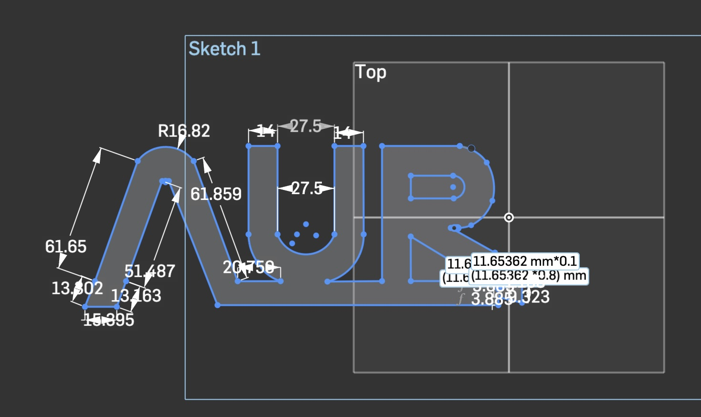
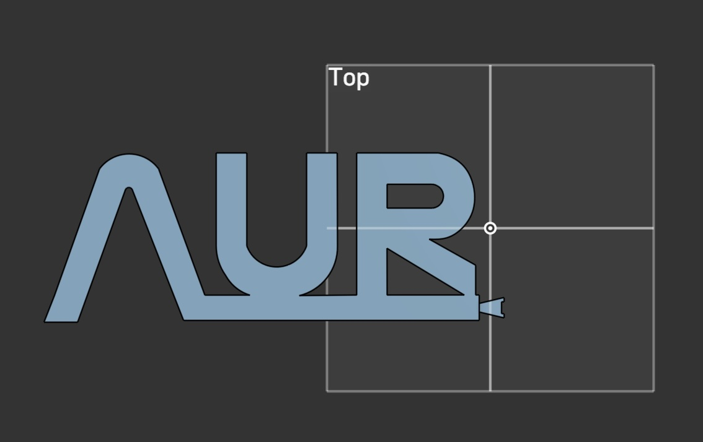
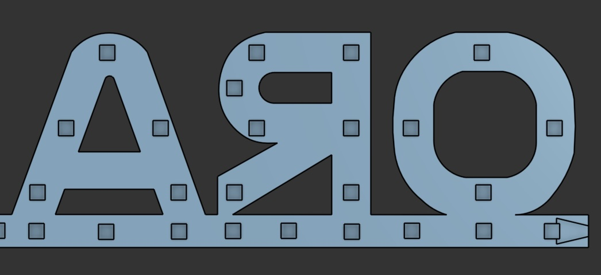
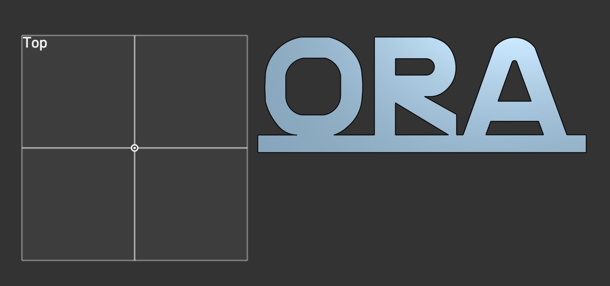
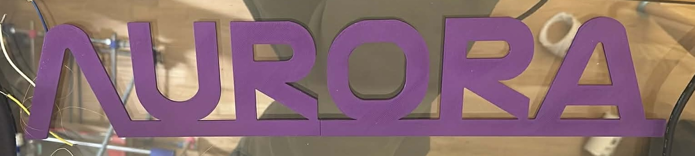
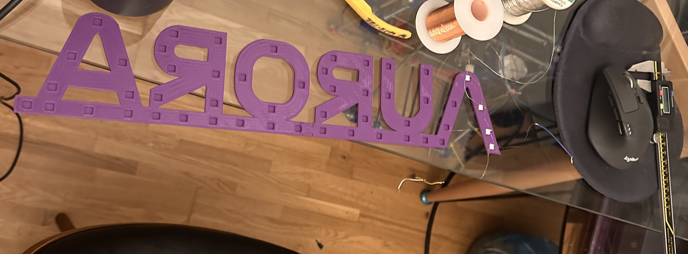
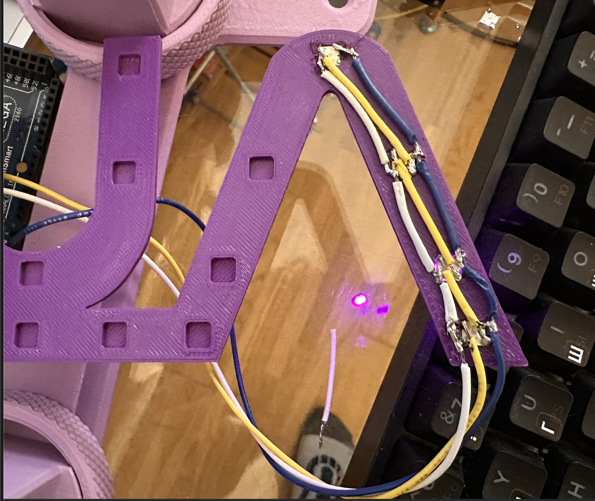

# Aurora Sign
---

## 08/03/26
So, I need a sign that says "Aurora". I thought it would be cool to use the
NASA type font, so I found a site that generates you NASA text, and downloaded
the image. I then imported that to OnShape, and drew around it:




You'll notice that this is only half of the word. I wanted the sign pretty big,
so I made it 400mm, but, my print bed is only 200x200. So, I cut the design, and
added a dove tail joint so that I can join the two parts of the sign together. 



Then, I extruded the part.

 

Then, I needed LED holes! I had 50 of [these](https://uk.rs-online.com/web/p/leds/1808083) RS components LEDS, which are pretty
much neopixel LEDS, but with a slightly different pin out - same library works
with it, though.

Next, it was time to print. I loaded up both parts into OrcaSlicer, and an hour
later I had my two part sign!



There we have it!

## 10/03/26

Okay, so I've been working on this a little, but not much. Tomorrow is the
deadline, so I will have to pick up pace then. For now, I changed tack a little.

 

Above we have two images. I initially started with very thin, 0.8mm, enameled
wire. This was, I thought, a good idea. I could quickly tack them on to each pad
that I needed. It was thin enough to quickly burn through the enamel and solder
to the pad. They'd be thin, won't short out when touching each other, etc. Alas,
it didn't work out that way. I was getting a lot of lack of contact between wire
and pad, they were brittle and would snap, there's no rigidity and so wouldn't
stay in place, etc. etc.. So, I went with the more standard approach - using 22
AWG wire. You can see how I've daisy chained them on the image on the right. I
now have a bunch more to do (but only ~50 LEDs available). I'll get all these
done tomorrow. Currently, the code is very simple and turns on each LED
sequentially, in purple.

I also had an issue with oddities when string the LEDs together. The first would
illuminate fine, but the second, third, forth, would change colour and
eventually start "double counting" as if LEDs $$X$$ and $$X+1$$ were the same.

The issue was that these LEDs are RGB_W_. I forgot about the _W_. Easy fix in
code. I'll probably share the code here when I'm done (simple Arduino C++ code)
and some oscilloscope shots of the data lines out of interest, too. But, only
when I've soldered all those LEDs!

## 13/03/26

<iframe width="560" height="315" src="https://www.youtube.com/embed/Z5suf64Qr8A?si=qyUN-N6rT_Y287wB" title="YouTube video player" frameborder="0" allow="accelerometer; autoplay; clipboard-write; encrypted-media; gyroscope; picture-in-picture; web-share" referrerpolicy="strict-origin-when-cross-origin" allowfullscreen></iframe>

Okay, not too much of an update here -- basically, I have soldered a few more
LEDs and printed a base. The base is very much the same idea as the sign, I used
dove tail joints, and there's a hollow section at the bottom that houses the
arduino. Once I have more LEDs soldered, I'll give a full update, this will
probably be the penultimate update (not much more interesting to update on
until it's all soldered up!)

## 26/03/26

Nothing too much to update, about a week ago I did more LEDs and got this nice
smooth transition going:

<iframe width="560" height="315" src="https://www.youtube.com/embed/mEiduGrFGz8?si=9JxrB3jvi8eGoUE9" title="YouTube video player" frameborder="0" allow="accelerometer; autoplay; clipboard-write; encrypted-media; gyroscope; picture-in-picture; web-share" referrerpolicy="strict-origin-when-cross-origin" allowfullscreen></iframe>

I haven't had much time to continue with this as I've been pushing for the
[Rocket Clock](../led_streaming_display___rocket_countdown/index.md) project to
be completed before Artemis 2 launch on 1st April. I'll leave this here for now
to mark some progress, hopefully I'll get more done after the Rocket Clock.

## 18/11/26

Okay, so I kinda finished this, and by finished, I mean got to a point where I
could give it to my daughter and she's happy with it. Having said that, she
still would like all the "lights to go all around the letters".

Currently, and maybe I'll upload a photo or video some other time, they only go
from the first 'A', around, and down the line underneath. It's about 15 LEDs,
and as I recall, they took a long time to solder up. It's a pain, really. Each
one is daisy chained to the next with too thick or multicore wire. I might
design some short lengths of PCB strips to carry the NEO pixels and slot those
in, but not sure how I'd do the curved pieces. I wouldn't want to make custom
shaped PCBs to fit the letters, as it'll cost too much. 

Anyway, I mostly wanted to update this to add the code, as I actually couldn't
find the original and had to re-write it again. So, to stop that, I'll document
it here.

```arduino

#include <Adafruit_NeoPixel.h>

#define PIN_1       6

#define NUM_LEDS   19
#define TAIL_LEN    6
#define STEP_MS     200
#define PATTERN_MS  80000UL
#define SOLID_MS    2000UL

#define NUM_COLORS  6
#define HUE_STEP    (65536 / NUM_COLORS)

// WS2811F is GRB byte order
Adafruit_NeoPixel strip(NUM_LEDS, PIN_1, NEO_RGBW + NEO_KHZ800);

// Sequence: COMET → RAINBOW → SPARKLE → PULSE → BOUNCE → WHITE → RED → repeat
enum State { COMET, RAINBOW, SPARKLE, PULSE, BOUNCE, WHITE, RED };

static State    state      = COMET;
static uint32_t stateStart = 0;

// COMET
static int      cometPos  = 0;
static int      cometDir  = 1;
static uint16_t cometHue  = 30254;
static uint8_t  cometPass = 0;

// RAINBOW
static uint16_t rainbowHue = 0;

// SPARKLE
static uint8_t  sparkleBri[NUM_LEDS];

// BOUNCE
static float    bouncePos = 0.0f;
static float    bounceVel = 0.0f;
static uint16_t bounceHue = 0;

void setPixel(int p, uint32_t c) {
    strip.setPixelColor(p, c);
}

void clearAll()          { strip.clear();  }
void showAll()           { strip.show();  }
void fillAll(uint32_t c) { strip.fill(c); }

void nextState() {
    stateStart = millis();
    switch (state) {
        case COMET:
            state = RAINBOW; rainbowHue = 0; break;
        case RAINBOW:
            state = SPARKLE; memset(sparkleBri, 0, sizeof(sparkleBri)); break;
        case SPARKLE:
            state = PULSE; break;
        case PULSE:
            state = BOUNCE; bouncePos = 0.0f; bounceVel = 0.0f; bounceHue = 0; break;
        case BOUNCE:
            state = WHITE; break;
        case WHITE:
            state = RED; break;
        case RED:
            state = COMET; cometPos=0; cometDir=1; cometHue=0; cometPass=0; break;
    }
}

void setup() {
    randomSeed(analogRead(0));
    strip.begin(); strip.setBrightness(127); strip.show();
    stateStart = millis();
}

void loop() {
    uint32_t now = millis();

    switch (state) {

        // --- bouncing comet, colour changes each pass ---
        case COMET: {
            clearAll();
            for (int i = 0; i < TAIL_LEN; i++) {
                int p = cometPos - cometDir * i;
                if (p < 0 || p >= NUM_LEDS) continue;
                uint8_t  bri = 255 * (TAIL_LEN - i) / TAIL_LEN;
                setPixel(p, strip.gamma32(strip.ColorHSV(cometHue, 255, bri)));
            }
            showAll();
            delay(STEP_MS);
            cometPos += cometDir;
            if (cometPos >= NUM_LEDS) {
                cometPos = NUM_LEDS - 1; cometDir = -1;
                // cometHue += HUE_STEP;
                // if (++cometPass >= NUM_COLORS) nextState();
            } else if (cometPos < 0) {
                cometPos = 0; cometDir = 1;
                // cometHue += HUE_STEP;
                // if (++cometPass >= NUM_COLORS) nextState();
            }
            break;
        }

        // --- full rainbow scrolling across all LEDs ---
        case RAINBOW: {
            for (int i = 0; i < NUM_LEDS; i++) {
                uint16_t h = rainbowHue + (uint16_t)(i * 65536L / NUM_LEDS);
                setPixel(i, strip.gamma32(strip.ColorHSV(h, 255, 255)));
            }
            showAll();
            rainbowHue += 512;
            delay(20);
            if (now - stateStart >= PATTERN_MS) nextState();
            break;
        }

        // --- white sparkle / glitter ---
        case SPARKLE: {
            for (int i = 0; i < NUM_LEDS; i++)
                sparkleBri[i] = sparkleBri[i] > 25 ? sparkleBri[i] - 25 : 0;
            if (random(3) == 0)
                sparkleBri[random(NUM_LEDS)] = 255;
            clearAll();
            for (int i = 0; i < NUM_LEDS; i++) {
                uint8_t b = sparkleBri[i];
                setPixel(i, strip.Color(b, b, b));
            }
            showAll();
            delay(30);
            if (now - stateStart >= PATTERN_MS) nextState();
            break;
        }

        // --- all LEDs breathing, hue slowly cycles ---
        case PULSE: {
            float phase = (now % 2000) / 2000.0f * 2.0f * 3.14159f;
            uint8_t  bri = (uint8_t)((sinf(phase) + 1.0f) / 2.0f * 255.0f);
            uint16_t h   = (uint16_t)((now % 10000) / 10000.0f * 65536.0f);
            fillAll(strip.gamma32(strip.ColorHSV(h, 255, bri)));
            showAll();
            delay(20);
            if (now - stateStart >= PATTERN_MS) nextState();
            break;
        }

        // --- single LED with gravity bounce, colour changes each drop ---
        case BOUNCE: {
            const float gravity     = 0.10f;
            const float restitution = 0.72f;
            const float minVel      = 0.50f;

            bounceVel += gravity;
            bouncePos += bounceVel;

            if (bouncePos >= (float)(NUM_LEDS - 1)) {
                bouncePos = (float)(NUM_LEDS - 1);
                bounceVel = -bounceVel * restitution;
                if (fabsf(bounceVel) < minVel) {
                    bouncePos = 0.0f;
                    bounceVel = 0.0f;
                    bounceHue += HUE_STEP;
                }
            }

            clearAll();
            int led = (int)(bouncePos + 0.5f);
            if (led >= NUM_LEDS) led = NUM_LEDS - 1;
            setPixel(led, strip.gamma32(strip.ColorHSV(bounceHue, 255, 255)));
            showAll();
            delay(20);

            if (now - stateStart >= PATTERN_MS) nextState();
            break;
        }

        // --- solid white 2s ---
        case WHITE: {
            fillAll(strip.Color(255, 255, 255));
            showAll();
            if (now - stateStart >= SOLID_MS) nextState();
            break;
        }

        // --- solid red 2s ---
        case RED: {
            fillAll(strip.Color(255, 0, 0));
            showAll();
            if (now - stateStart >= SOLID_MS) nextState();
            break;
        }
    }
}
```

and the make file:

```make
FQBN   = arduino:avr:mega

PORT  ?= /dev/cu.usbmodem1201
HERE   = $(dir $(abspath $(lastword $(MAKEFILE_LIST))))
SKETCH = $(HERE)ws2811_test

.PHONY: compile upload flash monitor clean

compile:
	arduino-cli compile --fqbn $(FQBN) $(SKETCH)

upload:
	arduino-cli upload -p $(PORT) --fqbn $(FQBN) $(SKETCH)

flash: compile upload

monitor:
	arduino-cli monitor -p $(PORT) --config baudrate=115200

clean:
	rm -rf $(SKETCH)/build
```

It's butchered from something Claude made a while ago, but I human'd it into
something fitting for this project.
